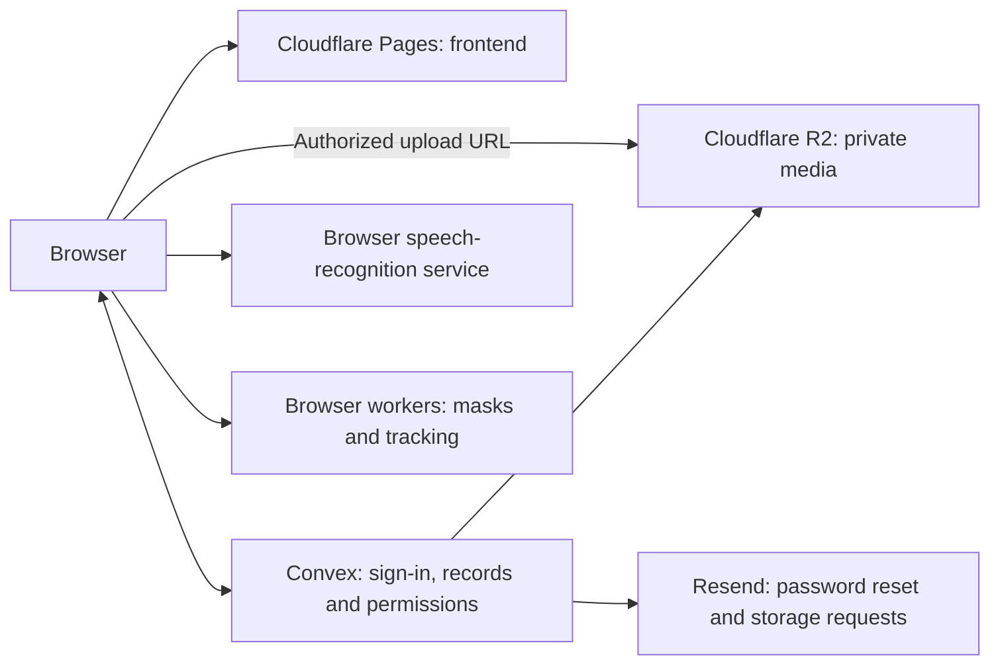

# Cheddar Vox — Technical overview

Last reviewed: 18 October 2026.

This document describes the current source in this workspace, covering **data annotation** and **video feedback**. It is an implementation reference, not a claim that every browser or deployed release was tested on this date. The older README contains historical setup and hosting details; use the current code and [AGENTS.md](AGENTS.md) for deployment decisions.

Website: [cheddarvox.com](https://cheddarvox.com/) · Video feedback: [cheddarvox.com/video-feedback](https://cheddarvox.com/video-feedback) · [GitHub repository](https://github.com/freshlybrewedcoffee19-maker/annotation-tool-v1)

## 1. Product and workflow boundaries

Cheddar Vox turns spoken instructions into saved records attached to visual media. Its two workflows share infrastructure but serve different jobs.

| | Data annotation | Video feedback |
|---|---|---|
| Main job | Label video moments or images for datasets | Give an editor feedback on exact moments in a video |
| Entry point | `/` | `/video-feedback` |
| Workspace | Projects containing uploaded videos and images | Project cards, each containing one video and its revisions |
| Main record | Label plus start/end time, or an image label/shape | Feedback text plus start/end time and video version |
| Spoken flow | “Start” → “stop” → say a label | “Start” → “stop” → say what should change |
| Review | Verify, disqualify or correct annotations | Play the marked clips, reply, revise and approve |
| Main exports | CSV and JSON; specialist spatial exports | Word, Excel and copyable text |

The marketing workflow uses the same start/stop idea, but has its own interface, speech controller, permissions and database tables. It is not a second view over the annotation `segments` table. Marketing navigation, logo links and sign-in return paths stay within `/video-feedback`.

## 2. System architecture



The browser renders the app, controls playback, processes speech results and creates downloads. Convex queries read records, mutations change records, and actions perform external operations such as file-storage requests. React subscriptions update the interface when saved records change.

| Layer | Current technology | Responsibility |
|---|---|---|
| Interface | React 19, TypeScript, CSS | Separate annotation and feedback experiences, responsive layouts and dialogs |
| Build | Vite 8 | Local development and production assets |
| Backend and database | Convex | Persistent records, access checks, scheduled cleanup and live updates |
| Authentication | Convex Auth, password provider, Google OAuth | Account creation, sign-in and password recovery |
| Website hosting | Cloudflare Pages | Serves the built frontend at `cheddarvox.com` |
| New private media | Cloudflare R2 through the AWS S3-compatible SDK | Videos, images and supported feedback audio |
| Earlier media | Convex file storage | Retained older uploads and sample references |
| Speech | `SpeechRecognition` / `webkitSpeechRecognition` | Browser-provided speech-to-text and command recognition |
| Optional visual assistance | ONNX Runtime Web, Transformers.js, browser workers | Local model inference for mask suggestions and tracking |
| File packaging | `fflate`, browser Blob/download APIs | Office files and annotation archives |
| Testing | Vitest, `convex-test`, Playwright | Backend rules, speech logic and browser flows |

Exact dependency versions are recorded in [package.json](package.json) and [package-lock.json](package-lock.json). Speech recognition may use the browser vendor's online service; it is not guaranteed to run locally or offline. Voice command parsing uses application rules, not a general-purpose language-model agent.

## 3. Routes and frontend structure

The application chooses a workflow from the URL in [src/main.tsx](src/main.tsx). Navigation is implemented in application code rather than a separate routing library.

| Route | Purpose |
|---|---|
| `/` | Data annotation landing page |
| `/signin`, `/upload` | Annotation sign-in and upload entry |
| `/workspace` | Account projects, or the anonymous trial workspace depending on browser state |
| `/annotate` | Main annotation tool |
| `/services` | Dataset-services enquiry flow |
| `/v2` and its subpaths | Separate spatial video annotation workspace |
| `/video-feedback` | Video-feedback landing page |
| `/video-feedback/signin` | Marketing sign-in experience |
| `/video-feedback/workspace` | Video-feedback project cards |
| `/video-feedback/sample` | Sample feedback experience without sign-in |
| `/video-feedback/cards/:id` | Video, feedback and revisions within a project card |
| `/video-feedback/review/:token` | Shared, read-only review link |
| `/video-feedback/invite/:token` | Accept an editor invitation |

Legacy `/marketing`, `/video-feedback/board` and singular `/video-feedback/card/...` paths are normalized by [src/marketing/routes.ts](src/marketing/routes.ts). Sign-in return URLs are restricted to accepted routes within the feedback workflow.

## 4. Data annotation

### User flow

1. Try the supplied sample, or sign in and upload a video or image into a project.
2. Open annotation directly. Mandatory label and metadata setup is not part of the current upload flow; older metadata records and helpers still exist for compatibility.
3. For video, turn on the mic, say “start” to play and mark the beginning, then “stop” to pause and mark the end. Say the label to save that interval.
4. For images, speak a label for the whole image. Image labels do not require start/stop times. Manual labels and spatial tools are also available.
5. Review saved work, correct it, and export the relevant records.

Video labels can be free-form speech; users do not need to define a fixed vocabulary first. “Start” and “stop” can react to interim speech results; labels and dashboard commands such as “play video” and “pause video” wait for final results. Times come from the video player. The backend requires a nonempty label and `0 ≤ start < end ≤ video duration`. Manual controls provide an alternative when speech is unavailable.

Uploads accept MP4, MOV and WebM video, plus JPEG, PNG and WebP images. The main video voice-save retry queue stays in component memory; image-label retries are saved locally and use duplicate-save keys. Do not promise that unsaved video labels survive a refresh.

The main editor also contains object boxes/polygons, object-to-action links, visibility/reappearance spans, frame masks and assisted tracking. These have distinct records and review rules. Model suggestions require human confirmation; they are not automatically trusted ground truth. V2 is a separate spatial editor with its own shape records and export rules.

SlimSAM provides point-guided mask suggestions; NanoTrack V3 proposes short tracking runs. Both process frames in browser workers. Manual movement interpolation between two verified boxes is a separate feature. Object detection and the dedicated “Team review” activity remain marked as pending, even though project sharing and collaborator roles already exist.

### Records and relationships

| Table or group | Stored information |
|---|---|
| `workspaces` | Browser workspace key, workspace kind, optional account owner and account grouping |
| `projects`, `projectVideos` | Project grouping and links to media |
| `episodes` | One video or image: filename, dimensions, duration, storage reference and per-media label list |
| `segments` | Video label, `start_sec`, `end_sec`, episode/workspace IDs, review status, optional source and segment number |
| `imageLabels` | Image label, normalized text, save key, source and review status |
| `objects`, `objectBoxes`, `objectVisibility` | Object identities, geometry and visibility spans |
| `trackSuggestions` | Proposed tracking results and review state |
| `pixelMasks`, `maskPixels` | Frame-mask metadata and compressed pixel runs |
| `v2Videos`, `v2Shapes` | Media and reviewed shapes in the separate V2 editor |
| `trialEditHistory`, `trialHistoryState` | Retained trial changes for undo/redo |
| `videoSessions`, `videoLeases` | Resume position and a temporary editing lock |
| `projectMembers`, `projectInvites` | Shared-project roles and invitations |

The usual ownership path is `segment → episode/workspace → user`. A segment ID identifies a saved annotation; it is not an account ID. The main `segments` schema does not store a separate author ID for each record, so account ownership alone cannot identify which collaborator created it.

An episode's saved **label list** is different from a saved **timed segment**. A phrase can exist in `episodes.labels` without a start/end interval in `segments`; labels can also be inherited from settings or seeded with sample media. Usage reporting should distinguish configured or inherited label lists from saved annotations, and inspect the relevant annotation tables for each workflow.

### Review, exports and collaboration

- Pending and verified temporal annotations are included in the standard CSV/JSON exports; disqualified and hidden records are excluded. Editing a timed annotation resets its review state to pending.
- Image labels have their own review/export path. Tracking, masks and V2 exports apply additional confirmation rules; their criteria are not interchangeable with temporal exports.
- V2 can package verified boxes/polygons with extracted frames as a COCO-format archive, a common dataset format for image annotations. It does not export all shape kinds through that route.
- V2 also has verified-segment CSV and current-frame YOLO box exports. Its full backup is broader and can include unverified records and pending device edits; a backup is not a reviewed training dataset.
- Shared projects distinguish owner, annotator and reviewer. Reviewers can review/correct existing annotations, but adding new annotations requires the appropriate role.
- A temporary per-video editing lock reduces simultaneous edits; it is not a full collaborative text editor.

Key code: [VoiceLabels.tsx](src/VoiceLabels.tsx), [voice-segments.ts](src/voice-segments.ts), [ImageWorkspace.tsx](src/ImageWorkspace.tsx), [annotations.ts](convex/annotations.ts), [images.ts](convex/images.ts), [projectAccess.ts](convex/projectAccess.ts), [V2 exports](src/v2/exportPackage.ts).

## 5. Video feedback

### User flow and speech handling

1. Try the dedicated sample, or sign in and upload a video. A completed upload creates a project card.
2. Turn on the mic. “Start” begins playback and marks the interval's start; “stop” pauses and marks the end.
3. Speak feedback for that interval. The interface shows transcription activity and editable text.
4. Settled speech is automatically queued for saving after a short pause, currently 1.5 seconds after final speech. New speech postpones the save. Starting another interval can also commit the previous completed feedback.
5. Select a saved feedback item to play its marked interval. Edit the text/timing, share it with an editor, or download the saved feedback.
6. An authorized editor uploads revisions into the same card. The owner reviews and approves the latest version, then can finalize the project.

Command recognition is separate from feedback dictation so “start” and “stop” can control playback without being appended as feedback. The speech session manages connecting, listening, reconnecting and error states. Mobile playback is prepared during the user's mic-button interaction, because browsers can require a physical gesture before playback.

On **iPhone, iPad and Android**, the feedback workflow intentionally saves speech as **text only**. This avoids a second microphone capture interrupting the phone's speech service. Supported desktop sessions can also capture feedback audio. Stored audio is optional; a text-only item remains valid feedback.

The feedback save queue uses a stable client save key to avoid duplicate records on retries. Drafts and queued feedback are stored in IndexedDB, the browser's local database, scoped to account, card and version. Draft/queue recovery and interrupted-upload recovery help preserve work after failures. They do not make the complete product offline-capable, and exports contain saved items rather than unsaved drafts. A feedback recording still needs transcript text before it can finish saving.

### Cards, versions and access

| Table | Stored information |
|---|---|
| `marketingCards` | Owner, title, stage, latest/approved version and finalization state |
| `marketingVersions` | Video version number, file reference, uploader, dimensions and deletion marker |
| `marketingUploads` | Reserved/completed uploads for video and optional audio |
| `marketingFeedback` | Version-specific time range, text, author, optional audio, save key and review state |
| `marketingReplies` | Replies with author and creation time |
| `marketingAccess` | Editor requests, invitations, acceptance and removal |
| `marketingLinks` | Public review-link tokens and revocation state |
| `marketingTickets` | Short-lived private media access tickets |
| `marketingEvents` | Saved activity such as uploads, feedback and approval |

Card stages are `needs_feedback`, `changes_requested`, `revised` and `approved`. Finalization and cleanup are separate fields. Revisions belong to the original card; they do not become unrelated project cards.

Anyone holding an active public review link can view the shared content without signing in. The public view is read-only. Uploading revisions requires a signed-in owner or active editor access. Editor invitations are tied to the invited email and expire after seven days. A viewer can sign in to request editor access from the owner; approving that request also grants editor access. Only the owner or feedback author can edit or resolve an item; active editors can reply.

Creating an editor invitation produces a link and an email draft; **it does not send an email automatically**. This differs from password-reset and storage-request emails, which the backend sends through Resend.

### Exports and finalization

Feedback exports are generated in the browser for the selected version: **Word `.docx`**, **Excel `.xlsx`**, and **copyable text**. They contain saved feedback and timing information; linked media still requires valid access and a connection. The Office files do not embed the full videos or original voice recordings. Project settings also offer a JSON report of saved card/version/feedback records and recent activity; it does not calculate inferred KPI scores.

Finalization is owner-controlled and requires approval of the latest version. The interface presents a deletion plan; the backend checks that the version list has not changed before deleting older video files. The latest video, feedback, replies and retained recordings remain. Old version records receive deletion markers, so historical feedback can remain even when its original footage no longer plays. Failed cleanup can be retried; reopening does not restore deleted footage.

Key code: [MarketingApp.tsx](src/marketing/MarketingApp.tsx), [FeedbackComposer.tsx](src/marketing/FeedbackComposer.tsx), [voice-session.ts](src/marketing/voice-session.ts), [voice-platform.ts](src/marketing/voice-platform.ts), [feedback-autosave.ts](src/marketing/feedback-autosave.ts), [marketing.ts](convex/marketing.ts), [marketingFiles.ts](convex/marketingFiles.ts), [office-export.ts](src/marketing/office-export.ts).

## 6. Authentication, samples and privacy

Both workflows share Convex Auth accounts. Password signup/sign-in is configured; Google sign-in is enabled when its backend credentials are configured. Password recovery uses emailed codes when Resend is configured. Signup does not require an email-verification step in the current auth configuration.

Annotation trial workspaces use random 256-bit browser access keys. Account-owned workspaces additionally require the matching signed-in user. Episode and project access is checked on the backend, not only by hiding buttons. Workspace keys, review/invitation tokens and private file URLs must be treated as access credentials.

The two samples have different persistence:

- **Annotation sample:** records can be saved in an anonymous Convex trial workspace. The same browser can later record an account association in `trialAccountLinks`. This association supports attribution; it does not move trial work into the account or grant access to another workspace.
- **Video-feedback sample:** uses a local in-memory sample store. Refreshing resets the practice session; its feedback is not a production Convex usage record.

Therefore, account totals, anonymous workspace totals and distinct people are different measures. Clearing browser storage or using another browser can create another anonymous identity. A missing account link does not prove no activity took place. Tests can inject speech and save records marked `voice`; that field alone cannot establish real human usage.

Key code: [auth.ts](convex/auth.ts), [access.ts](convex/access.ts), [accounts.ts](convex/accounts.ts), [TrialAccountLink.tsx](src/TrialAccountLink.tsx), [sample hooks](src/marketing/hooks.tsx).

## 7. Media storage and upload lifecycle

New signed-in uploads use private R2 storage. Convex keeps the permissions, file metadata and references rather than the video bytes.

1. The browser reads the media information and requests an upload reservation.
2. The backend verifies account/project permission and storage allowance, then issues a temporary signed upload URL.
3. The browser sends the file directly to R2. The feedback uploader reports transfer progress and supports recovering an interrupted finalization step. File transfer retries resend the whole file; multipart upload with byte-level resume is not implemented.
4. The backend checks the uploaded object's size and content type, copies it from staging to a permanent private key, and creates the media/version record. Retried completion calls return the existing result when possible.
5. Staging copies are removed after successful completion where possible, or by scheduled cleanup after expiry.

Annotation playback uses authorized, time-limited R2 download URLs. Feedback playback goes through `/api/marketing/media`, which checks the review link or private ticket and supports byte-range requests for seeking. Earlier Convex-hosted files remain supported. Videos are not automatically transcoded or compressed during upload; size, connection speed and browser codec support still affect upload/playback.

The backend checks size and declared content type; this is not a full media-content inspection service.

## 8. Quotas, paid storage requests and retention

Current constants are in [freeLimits.ts](convex/freeLimits.ts).

| Rule | Current behavior |
|---|---|
| Free account storage | 1,000,000,000 bytes: 1 GB shared across both workflows |
| Pending uploads | Reserve space until completed, cancelled where supported, or cleaned up |
| Video size | Up to 250,000,000 bytes per video |
| Annotation projects | Up to five active projects |
| Feedback audio | Up to 20,000,000 bytes per recording |
| Site-wide guard | A separate 6 GB accounting cap includes temporary upload copies |
| Extra-storage price shown | USD 0.020 per additional GB-month |

The extra-storage dialog sends a signed-in account's request and usage details to `riya.shah@cheddarvox.com`. Delivery has retries and duplicate-send protection. **Requesting storage does not charge a card or increase the quota.** Automatic payment collection and paid storage entitlements are not implemented by this request flow.

Hourly jobs clean expired staging uploads and expired annotation Trash. Annotation Trash has a seven-day restore window. Marketing older-version deletion follows explicit finalization, not the annotation Trash policy. Current cleanup behavior must be checked when adding new media kinds; do not assume all storage paths share the same deletion rules.

Key code: [storageRequests.ts](convex/storageRequests.ts), [storageRequestEmail.ts](convex/storageRequestEmail.ts), [StorageLimitDialog.tsx](src/StorageLimitDialog.tsx), [crons.ts](convex/crons.ts), [trash.ts](convex/trash.ts).

## 9. Local setup and configuration

Use a test/development Convex deployment when developing or running tests that create records. The checked-in deployment script targets the existing live service, even though its Convex deployment setting uses a `dev:` prefix.

```powershell
cd C:\Users\Riya\build-sprint-app
npm ci
# Connect a development backend; confirm the selected deployment.
npx convex dev
# In a second terminal, from the same project folder:
npm run dev
```

Keep local configuration in ignored `.env.local` files. Browser configuration includes `VITE_CONVEX_URL`, optional `VITE_CONVEX_SITE_URL`, and optional `VITE_TRIAL_VIDEO_PATH`. Values beginning with `VITE_` are exposed to the frontend and must not contain secrets.

Backend configuration includes `AUTH_GOOGLE_ID` / `AUTH_GOOGLE_SECRET` for Google, `RESEND_API_KEY` for email, and `R2_ENDPOINT`, `R2_BUCKET`, `R2_ACCESS_KEY_ID`, `R2_SECRET_ACCESS_KEY` for private media. Convex Auth also needs its generated signing and site configuration. R2 must allow the intended browser upload origins and methods. Configure credentials through the appropriate service/environment; do not paste them into source or this document.

Model and notice preparation runs before `npm run build`; a clean build can require downloading model assets. Older setup docs do not override the current Cloudflare hosting choice.

## 10. Validation and release

| Command | What it checks or does |
|---|---|
| `npx tsc --noEmit` | Type checks the frontend and backend source |
| `npx vitest run` | Runs the configured `backend-tests` suite, including local Convex simulations and pure logic tests |
| `npm test` | Runs Playwright against `APP_URL`, or the default local development URL |
| `npm run build` | Prepares model/notices, type checks and builds the frontend |
| `npm run deploy` | Updates the configured Convex backend, builds, uploads to Cloudflare Pages and checks the live frontend assets |

Browser tests can create uploads, accounts and annotations in the connected backend. Use a separate test deployment, record test identifiers, and do not run the suite against customer data as a harmless health check. Simulated speech tests exercise command handling; physical Android/iPhone/desktop microphone tests are still necessary for speech regressions.

The deployment check verifies that `/`, `/video-feedback` and `/video-feedback/sample` serve the expected built JavaScript/CSS assets. It does not prove that sign-in, permissions, real microphone input or upload recovery works end to end. Validate the affected flow after release.

GitHub stores code/history; a Git push does not deploy the website. Cloudflare Pages is the current public frontend host. The Convex static-hosting component remains in configuration for legacy compatibility, while public frontend GET routes on the Convex site redirect to `cheddarvox.com` and backend/auth routes remain in Convex.

Deployment sources: [scripts/deploy.mjs](scripts/deploy.mjs), [scripts/verify-deployment.mjs](scripts/verify-deployment.mjs), [convex/http.ts](convex/http.ts).

## 11. Maintenance rules

- Preserve the separation between annotation records and marketing cards/feedback. Shared auth or storage changes must be checked in both workflows.
- Preserve media aspect ratios and make layout respond to available viewport width and height. Scrolling feedback strips or dialogs should not resize the entire tool unexpectedly.
- Keep manual playback and text-edit controls available when speech fails. Require microphone permission and handle unsupported browsers visibly. Headphones help avoid video audio being recognized as commands; they do not fix every browser or device limitation.
- Keep the feedback text-only phone path. Test stop timing, restart after dictation, autosave, hidden tabs and concurrent microphone use before changing speech controllers.
- Treat retry save keys, storage reservations, invitation checks and finalization checks as correctness requirements. Removing them can cause duplicates, unauthorized changes or data loss.
- Keep private audits, account exports, `.env` files and recovery links out of the public repository. Repository visibility does not make private R2 objects or Convex account records public.
- Recheck code when updating this document. Do not turn sample sessions, test fixtures or workspace counts into verified customer-usage claims.

## 12. Product usage tracking

The separate `productEvents` table records activity from the point this feature is deployed. It does not reconstruct historical activity or change saved annotations, feedback, speech handling, sign-in, media storage or hosting.

| `name` | When it is sent | What the count means |
|---|---|---|
| `recording_attempt` | A user deliberately turns on the microphone in video annotation, image annotation or video feedback | Mic-on attempts, including attempts that later fail. Automatic recognition restarts do not count again. One attempt may produce several notes; this is not a count of individual note attempts. |
| `save_succeeded` | An existing save operation confirms a video segment, image label or feedback record | Each persisted record is measured once. Edits do not count. A retry or duplicate image label can return an already-existing record; its first confirmation after rollout can count once, so this is not a record-creation count. |
| `clip_play` | A selected video-feedback clip emits the browser's `playing` event for the expected video and time range | Playback starts, not clicks, full-video views or proof someone watched the entire clip. Buffering resumes do not count again. Annotation seek controls are not counted as editor clip plays. |

In Convex, open **Data → productEvents** and filter `traffic = live`. Separate `workflow = annotation` from `workflow = marketing`, and group `sample = true` separately from uploaded user media. `actorRole = editor` identifies a signed-in editor with current access; `public_reviewer` means someone using a valid review link, whose identity need not be known. Owner plays are marked `owner` and can be excluded from editor-engagement reports.

`createdAt` is the server's event-receipt time, in milliseconds since the Unix epoch. Convert it to the reporting timezone before grouping by date. `actorId` identifies a signed-in account when available; otherwise `visitorId` identifies a browser, not a verified person. `sessionId` identifies the browser-tab session. Reinstalled browsers, cleared storage, different devices and restricted storage can produce additional visitor IDs. Do not add account counts and visitor counts without reconciling overlapping IDs.

Localhost traffic is `local`; automated-browser tests, test builds, explicit example/preview URLs and known test workspaces/accounts are marked `test`. These labels are not a guarantee that every manually conducted test has been identified. Normal public sample use remains `live` with `sample = true`. Annotation source is read from its saved record (`voice`, `manual` or `unknown`). Marketing phone feedback can be text-only after voice capture, so absence of an audio attachment is `unknown`, not proof of typing; in-memory marketing sample source is also `unknown`.

The table stores event names, times, anonymous browser/session IDs, account and record references, and classification fields. It does not store transcript text, audio, names, email addresses, IP addresses, full URLs, workspace access keys or review-link tokens. Existing access keys are sent only to check access and are excluded from stored event rows. No user-facing analytics read endpoint is added.

Tracking is best effort and runs after the user action without waiting for a tracking response. Requests are bounded in memory, duplicate save events are rejected on the server, and tracking errors are swallowed. Network loss, navigation, backend rejection or the per-session rate limit can drop events. Use saved records as the source of truth for persisted work; this table is an activity signal, not a complete audit or a basis for a failed-save percentage. Dividing saves by mic-on attempts would be misleading because one microphone session can save multiple notes.

The isolated tests intercept browser/backend traffic and create no live users or records. They cover tracking failures and hung requests while voice saves continue, recognition restarts, interrupted-note saving, image labels, record permissions, duplicate suppression and playback observation. Browser speech and media are controlled in these tests; they do not replace a physical-phone microphone check.

Implementation: `src/product-tracking.ts`, `src/product-clip-tracking.ts`, `convex/productEvents.ts` and `convex/productEventSchema.ts`. Tracking requires deploying both the new backend function/table and the frontend hooks through the existing release process. An older or unavailable tracking backend must not prevent voice, saves or playback from working.
